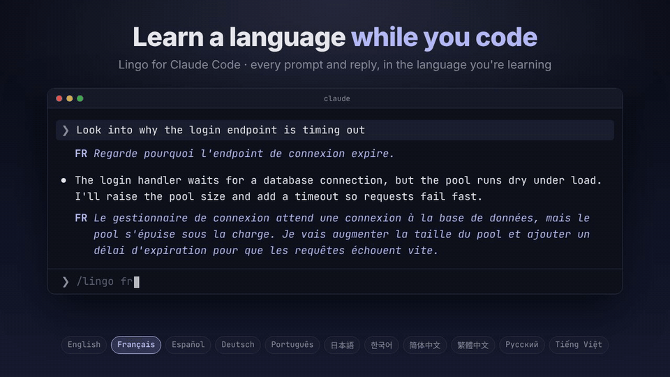
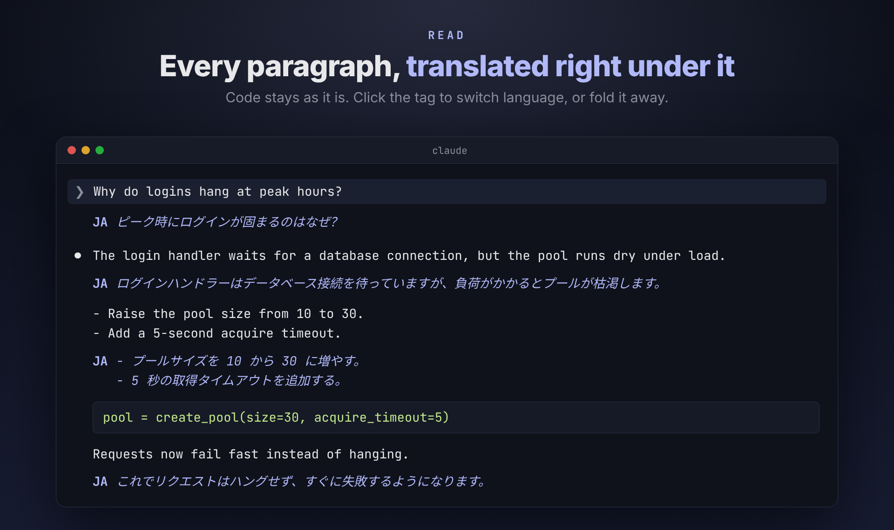
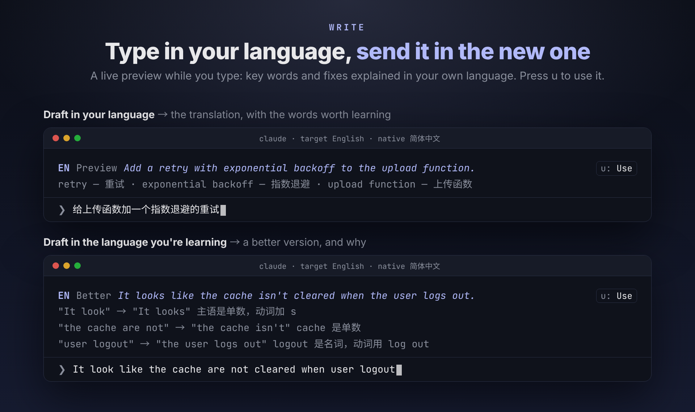
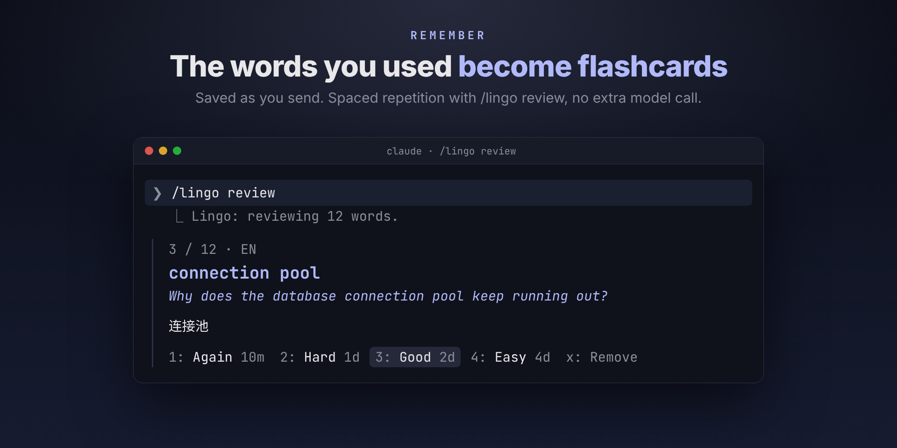

# Lingo

[English](README.md) | [简体中文](README.zh-CN.md) | [繁體中文](README.zh-TW.md) | [日本語](README.ja.md) | **한국어** | [Français](README.fr.md) | [Español](README.es.md)

<p align="center">
  
</p>

<p align="center"><b>코딩하면서 외국어를 익히세요.</b><br>
English · Français · Español · Deutsch · Português · 日本語 · 한국어 · 简体中文 · 繁體中文 · Русский · Tiếng Việt</p>

하루에 몇 시간씩 Claude Code로 읽고 쓰고 계시죠. Claude Code 플러그인 Lingo는 그 시간을 어학 연습으로 바꿔 줍니다. 연습 재료는 여러분이 진짜 궁금해하는 기술 문장들입니다.

- **읽기.** 모든 프롬프트와 답변 아래에, 학습 중인 언어의 번역이 문단마다 붙습니다.
- **쓰기.** 모국어로 입력하면 보내기 전에 학습 중인 언어로 된 문장을 확인할 수 있고, 핵심 단어 설명도 함께 나옵니다. 학습 중인 언어로 직접 쓰면 더 자연스러운 표현을 제안하고, 이유는 모국어로 설명합니다.
- **기억하기.** 사용한 단어는 단어 카드가 되어 간격 반복 일정에 따라 복습할 수 있습니다.

11개 언어 중 원하는 언어를 배울 수 있고, 설명은 나머지 어떤 언어로든 받을 수 있습니다. Claude에게 보내는 내용은 절대 바뀌지 않습니다. Lingo는 그 주변에 줄을 덧붙일 뿐입니다.

## 설치

Claude Code에서:

```
/plugin marketplace add royisme/lingo
/plugin install lingo --marketplace royisme/lingo
```

또는 셸에서:

```sh
claude plugin marketplace add royisme/lingo
claude plugin install lingo --marketplace royisme/lingo
```

그런 다음 `/config`를 열고 **Lingo**를 찾아 **Target language**(배우는 언어)와 **Native language**(모국어)를 설정하세요. 터미널, 데스크톱, VS Code, 모바일에서 사용할 수 있습니다.

## 배우는 방법

### 읽기: 모든 메시지를 학습 중인 언어로



프롬프트와 답변 아래에 언어 태그가 붙은 이탤릭체 번역이 나타납니다. 긴 답변은 문단 단위로 번역되어, 각 번역이 해당 문단 바로 아래에 놓입니다. 코드 블록, 경로, 명령어는 그대로 유지됩니다. 번역은 처음에 접혀 있어서(`▸ Translate`), 펼치기 전에는 번역도 비용도 발생하지 않습니다. 태그(`FR`, `JA`, `ZH` 등)를 클릭하면 그 자리에서 언어를 바꿀 수 있습니다.

### 쓰기: 모국어로 입력하고, 학습 중인 언어로 보내기



입력하다 잠깐 멈추면 프롬프트 입력창 위에 미리보기가 나타납니다.

- **모국어로 쓴 초안**은 번역과 함께, 배워 둘 만한 단어를 최대 다섯 개까지 보여 주며 각 단어에 모국어로 된 짧은 설명이 붙습니다. `u`를 누르면 번역이 입력창에 들어가 바로 보낼 수 있습니다.
- **학습 중인 언어로 쓴 초안**은 더 자연스러운 표현이 있으면 제안해 주고, 바뀐 부분마다 모국어로 이유를 설명합니다: `"It look" → "It looks"  주어가 3인칭 단수`. `u`를 눌러 적용하거나 직접 고치세요.

### 기억하기: 사용한 단어가 단어 카드가 됩니다



미리본 초안을 보내면 핵심 단어가 덱에 저장됩니다. 덱은 배우는 언어마다 하나씩 만들어집니다. 모델을 추가로 호출하지 않으며, 단어는 미리보기에서 그대로 가져옵니다. `/lingo review`를 실행해 카드마다 평가하세요: `1` Again, `2` Hard, `3` Good, `4` Easy. 카드는 간격 반복 일정에 따라 다시 나타납니다(계속 Good을 누르면 2일, 5일, 13일, 33일 뒤). 카드마다 그 단어가 나온 문장이 함께 표시되어, 단어를 문맥 속에서 익힐 수 있습니다.

## 플러그인 하나로, 어떤 언어 조합이든

11개 언어의 모든 조합이 가능합니다. 몇 가지 예를 들면 다음과 같습니다.

| 모국어 | 학습 중인 언어 | 이렇게 쓸 수 있어요 |
| --- | --- | --- |
| 한국어 | 日本語 | 한국어 답변 아래에서 일본어 읽기, 한국어 설명이 붙은 단어 카드 |
| 简体中文 | English | Claude의 중국어 답변 아래에 영어 번역, 중국어 초안을 영어로 미리보기, 문법 설명은 중국어로 |
| English | 日本語 | 모든 메시지 아래에 문단별 일본어 번역, 단어 설명은 영어로 |
| Español | English | 영어를 직접 쓰면 교정 이유를 스페인어로 설명 |
| Français | Deutsch | 모든 프롬프트와 답변 아래에 독일어 번역, 설명은 프랑스어로 |

바꾸고 싶을 땐 언제든지: 태그를 클릭하거나, `/lingo de`를 실행하거나, `/config`에서 변경하세요.

## 명령어

| 명령어 | 기능 |
| --- | --- |
| `/lingo fr` · `/lingo ja` · `/lingo zh-TW` … | 학습 중인 언어를 바꿉니다 |
| `/lingo off` | Lingo를 끕니다 |
| `/lingo show` | 최신 답변의 번역을 엽니다(행을 클릭할 수 없는 터미널용) |
| `/lingo review` | 복습할 차례가 된 단어 카드를 복습합니다 |
| `/lingo words` | 덱을 보여 줍니다: 단어 수, 복습 예정, 새 카드, 최근 10개 |
| `/lingo forget <word>` | 카드를 삭제합니다 |

대화 기록에서는 언어 태그를 클릭해 선택 창을 열 수 있고(언어 전환, 해당 줄 숨기기, Lingo 끄기), `Translation failed · Retry`를 클릭해 다시 시도하거나, 펼쳐진 번역을 클릭해 접을 수도 있습니다.

## 설정

모두 `/config`의 **Lingo** 아래에 있습니다.

| 설정 | 기본값 | 기능 |
| --- | --- | --- |
| **Target language** | `English` | 배우는 언어: `English`, `Français`, `Español`, `Deutsch`, `Português`, `日本語`, `한국어`, `简体中文`, `繁體中文`, `Русский`, `Tiếng Việt`, 또는 `Off` |
| **Native language** | `简体中文` | 모국어: 단어 설명과 해설이 이 언어로 작성됩니다. 선택지는 같지만 `Off`는 없습니다 |
| **Preview while typing** | `true` | 초안의 번역과 핵심 단어를 프롬프트 입력창 위에 실시간으로 보여 줍니다. `u`를 누르면 입력창에 들어갑니다 |
| **Suggest fixes while typing** | `true` | 초안이 이미 학습 중인 언어로 되어 있으면, 더 자연스러운 표현을 모국어 설명과 함께 제안합니다. `u`를 누르면 입력창에 들어갑니다 |
| **Translate my prompts** | `true` | 보낸 각 프롬프트 아래에 번역을 보여 줍니다 |
| **Translate Claude's replies** | `true` | Claude의 각 텍스트 답변 아래에 번역을 보여 줍니다 |
| **Fold translations** | `true` | 번역은 `▸ Translate`로 접힌 채 시작합니다. 펼치기 전에는 번역도 비용도 발생하지 않습니다. 끄면 프롬프트는 보낼 때, 각 턴의 최종 답변도 함께 번역됩니다 |
| **Save words as flashcards** | `true` | 미리본 초안을 보낼 때(또는 `u`를 누를 때) 핵심 단어를 저장해 `/lingo review`에서 쓸 수 있게 합니다 |
| **Provider** | `Claude` | `Claude`(Claude Code를 통해, 내 계정 사용) 또는 `OpenAI-compatible`(아래 참고) |
| **Translation model** | `haiku` | 별칭이나 전체 ID(`claude-haiku-4-5`), 또는 제공업체의 모델 이름. `haiku`를 쓸 수 없다면 전체 ID를 지정하세요 |
| **Provider URL** | `http://localhost:11434/v1` | `OpenAI-compatible`일 때: API 기본 주소이며 `/v1`로 끝납니다 |
| **Provider API key** | 비어 있음 | `OpenAI-compatible`일 때: 제공업체의 키(로컬 Ollama는 필요 없음). `settings.json`에 평문으로 저장됩니다 |

## 건너뛰는 항목

- **이미 학습 중인 언어로 된 텍스트.** 영어를 배우는 중에 메시지가 영어라면 아무것도 표시되지 않습니다. 영어와 프랑스어처럼 문자를 공유하는 언어는, Lingo가 가능한 한 로컬에서 판별하고 확신이 없을 때만 모델에게 묻습니다.
- **코드, 경로, URL.** `` `getUserById` `` 하나만 있거나 코드 블록뿐인 메시지는 모델을 호출하지 않고 건너뜁니다. 문장 속의 인라인 코드, 파일 경로, 슬래시 명령어, 플래그는 쓴 그대로 유지됩니다.

## 비용과 개인정보

기본적으로 번역 한 번은 Claude Code 자체 API를 통해 Claude의 `haiku` 모델을 짧게 한 번 호출하는 것입니다. 이미 쓰고 있는 계정과 결제 그대로이고, 외부 번역 서비스는 쓰지 않습니다. 접힌 번역은 펼치기 전까지 비용이 들지 않고, 긴 답변도 호출은 한 번이며, 단어 카드는 모델을 전혀 호출하지 않습니다. 일반적인 메시지 하나의 비용은 1센트도 되지 않습니다.

### 무료 및 로컬 모델(OpenAI-compatible)

Lingo는 OpenAI chat-completions API를 지원하는 모든 엔드포인트로 번역할 수 있으며, 무료이거나 완전히 로컬인 것도 포함됩니다. **Provider**를 `OpenAI-compatible`로 설정하고, **Provider URL**에 API 기본 주소를, **Translation model**에 제공업체의 모델 이름을 입력하세요. 키가 필요한 서비스는 **Provider API key**에 키를 넣으면 됩니다.

| 제공업체 | Provider URL | Translation model(예시) |
| --- | --- | --- |
| Ollama(로컬, 키 불필요) | `http://localhost:11434/v1` | `gemma4:cloud`(권장) |
| LM Studio(로컬, 키 불필요) | `http://localhost:1234/v1` | 로드된 모델의 이름 |
| OpenRouter | `https://openrouter.ai/api/v1` | `:free` 모델 |
| Groq | `https://api.groq.com/openai/v1` | `llama-3.1-8b-instant` |

요청은 Claude Code 자체 네트워크 계층을 거치므로 조직의 web-fetch 정책이 적용됩니다. 이런 제공업체를 쓰면 메시지가 설정한 엔드포인트로 전송되며, 해당 업체의 요금과 개인정보 약관이 적용됩니다. 추론 모델의 `<think>` 블록은 번역에서 제외됩니다.

## 디자인

디자인 결정 사항(주석 줄, 언어 태그와 메뉴, 미리보기 밴드, 문단 보기, 단어 카드, 설정, 색상, 문구)은 [docs/DESIGN.md](docs/DESIGN.md)에 정리되어 있습니다. 위의 이미지는 [promo/](promo/)를 바탕으로 [Remotion](https://www.remotion.dev)으로 만들었습니다.

## 개발

```sh
claude plugin validate .
claude plugin validate ./claude-code
claude plugin test ./claude-code
```

## 라이선스

[MIT](LICENSE)
